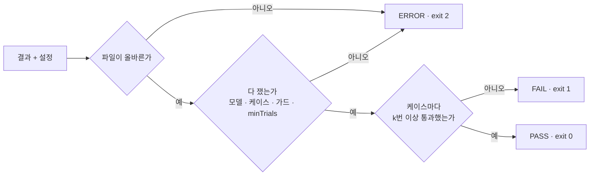

# eval-verdict

[](https://github.com/qwer906/eval-verdict/actions/workflows/ci.yml)
[](LICENSE)


여러 번 돌린 LLM 평가 결과를 **PASS / FAIL / ERROR** 하나로 판정해, 머지를 막을지 정하는 CLI·라이브러리입니다.

- **n번 중 k번.** 케이스마다 "2번 중 1번", "3번 중 2번"처럼 정합니다. 점수가 흔들려도 멀쩡한 PR을 막지 않습니다.
- **못 잰 것은 FAIL이 아니라 ERROR.** run이 무너졌거나 표본이 모자라면 exit 2를 냅니다. 회귀(exit 1)와 인프라 고장을 섞지 않습니다.
- **`replay`로 임계 변경 미리 보기.** 과거 결과에 새 설정을 적용해, 뒤집히는 판정을 먼저 보여 줍니다.
- **실제 게이트와 같은 판정.** 팀 프로젝트 게이트 기록 21건을 다시 판정해 21건 모두 같은 결과가 나왔습니다. → [검증](#실제-게이트로-검증)
- **런타임 의존성 0개, 순수 함수 판정.** `judge()`는 파일, 네트워크, 시계를 건드리지 않습니다.

## 예시

```console
$ eval-verdict check examples/reports/report-thin.json --config examples/config.json
eval-verdict: ERROR

       case                     passed        rule                  baseline
ERROR  answer-accuracy          1/1 (+1 n/m)  ≥1 of ≥2, score ≥ 80  -
ok     false-correct-pct        2/2           ≥1 of ≥2, score ≤ 10  -
ok     unrelated-false-correct  1/1           ≥1 of ≥1, score ≤ 1   -

errors — not measured, so no PASS/FAIL:
  - samples.graded-points: 120 outside guard n ≥ 200
  - answer-accuracy: 1 measured trials < minTrials 2 (1 not measured)
```

점수만 보면 통과지만, 채점한 표본이 가드보다 적고 run 하나가 무너졌습니다. 그래서 PASS가 아니라 **ERROR**입니다.

## 빠른 시작

```bash
npm install --save-dev github:qwer906/eval-verdict
```

평가를 돌린 쪽이 **결과 파일**을 쓰고, 임계는 **설정 파일**에만 둡니다.

<table>
<tr><th>report.json</th><th>gate.config.json</th></tr>
<tr><td>

```json
{
  "model": "grader-model-a",
  "cases": [
    { "id": "answer-accuracy", "trials": [92.5, 78.0] },
    { "id": "false-correct-pct", "trials": [2.2, 14.0] }
  ],
  "samples": { "graded-points": 430 }
}
```

</td><td>

```json
{
  "model": "grader-model-a",
  "pass": { "min": 80 },
  "minPassingTrials": 1,
  "minTrials": 2,
  "cases": {
    "false-correct-pct": { "pass": { "max": 10 } }
  },
  "guards": { "graded-points": { "min": 200 } }
}
```

</td></tr>
</table>

```bash
npx eval-verdict check  report.json      --config gate.config.json   # 0 PASS · 1 FAIL · 2 ERROR
npx eval-verdict replay history/*.json   --config gate.config.json   # 0 안 바뀜 · 1 바뀜
```

GitHub Actions에서는 같은 판정을 job summary 표로도 남깁니다.

<details>
<summary>라이브러리로 쓰기</summary>

```ts
import { judge, parseConfig, parseReport } from "eval-verdict";

const config = parseConfig(JSON.parse(configText));
const report = parseReport(JSON.parse(reportText));

if (config.ok && report.ok) {
  const { verdict, errors, failures } = judge(config.value, report.value);
}
```

</details>

## 어떻게 판정하나



못 잰 상태에서 나온 FAIL은 회귀인지 인프라 고장인지 알려 주지 않습니다. 그래서 ERROR를 FAIL보다 먼저 봅니다. 문제는 처음 하나에서 멈추지 않고 전부 모아 한 번에 보여 줍니다.

| 상황 | 판정 |
|---|---|
| 2번 중 1번이 임계를 넘음 (`minPassingTrials: 1`) | PASS (엇갈림 경고) |
| 2번 모두 임계를 넘지 못함 | FAIL |
| run 하나가 `null`(못 잼)이라 잰 trial이 `minTrials`보다 적음 | ERROR |
| 채점 표본이 `guards`보다 적음 | ERROR |
| 설정에 `minPasingTrials` 오타 | ERROR (모르는 키) |
| 다른 모델로 채점한 결과 | ERROR |

## 실제 게이트로 검증

이 도구는 비공개 팀 프로젝트에서 운영한 LLM 채점 게이트의 판정 부분을 떼어 낸 것입니다. 게이트 기록에는 당시의 임계와 가드가 함께 남아 있습니다. 그래서 기록마다 **그 기록 자신의 임계로** 다시 판정해, 기록된 판정과 비교했습니다.

| 기록된 판정 | 건수 | eval-verdict | 이유도 같은가 |
|---|---:|---|---|
| PASS | 16 | 16 PASS | — |
| FAIL | 1 | FAIL | 같은 지표가 걸림 |
| ERROR | 4 | 4 ERROR | 표본 가드 미달 3, 채점 모델 불일치 1 |

- **21건 모두 같은 판정이 나왔습니다.**
- 임계를 통과할 수 없는 값으로 바꾸면 PASS 16건이 모두 FAIL로 바뀝니다. 변환이 입력을 무시하는 것이 아니라는 확인입니다.
- **한계:**
  - 대상은 로컬에 남아 있던 기록 21건(2026-10-28 ~ 11-06)입니다.
  - 변환기는 팀 고유 코드라 이 레포에 없습니다.
  - 팀 게이트가 이 도구를 실제로 호출하도록 바꾸는 작업은 아직 하지 않았습니다.

## 문서

| 문서 | 내용 |
|---|---|
| [레퍼런스](docs/reference.md) | 설정 키, 결과 키, exit code, 라이브러리 API |
| [설계](docs/design.md) | 왜 이 규칙인가. 게이트에서 겪은 일과 기존 도구와의 차이 |
| [AGENTS.md](AGENTS.md) | 이 레포에서 작업하는 에이전트와 사람을 위한 규칙 |

## 개발

```bash
npm ci
npm run ci   # typecheck → lint → test(38) → build → smoke
```

- TypeScript strict에 `noUncheckedIndexedAccess`, `exactOptionalPropertyTypes`를 켰습니다.
- typescript-eslint는 `strictTypeChecked`를 씁니다.
- 테스트는 `node:test`로 돌립니다.
- `smoke`는 빌드된 CLI를 예시 파일로 실행해 exit code를 확인합니다.

## License

[MIT](LICENSE)
